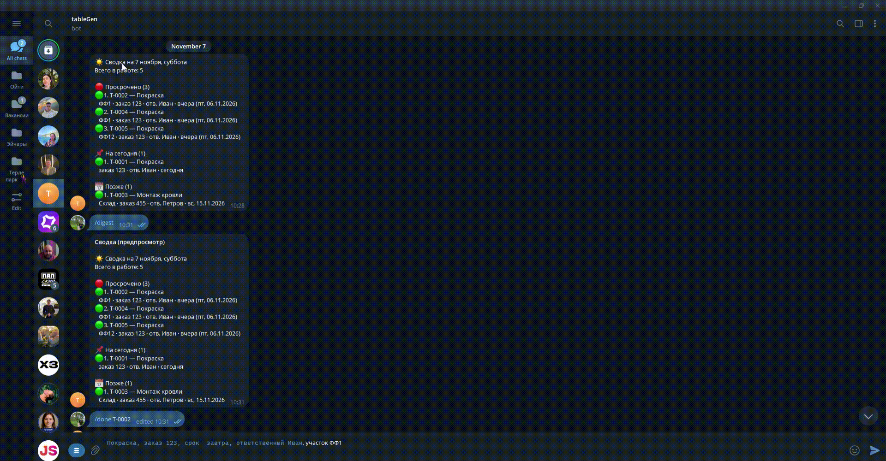

# Telegram-бот учёта задач

## 0. Краткое описание функционала

Бот принимает задачи **обычным сообщением на русском языке** и сам разбирает их на поля:

```
Покраска, заказ 123, срок пятница, ответственный Иван, участок ФФ1
        ↓
✅ T-0001 — Покраска
   участок: ФФ1 · заказ: 123
   срок: пт, 06.11.2026 · отв.: Иван
```

Что умеет:

- **Разбор текста.** Участок, заказ, срок, ответственный, вид работ, название.
  Сроки понимаются по-человечески: `завтра`, `пятница`, `15 ноября`, `через 3 дня`,
  `до конца месяца`, `срочно`, `14:30`. Несколько строк в сообщении = несколько задач.
- **Хранение в SQLite.** Всё в одном файле `data/bot.db`, без внешних сервисов.
- **Утренняя сводка** в заданное время по часовому поясу: просрочено, на сегодня,
  завтра, до конца недели. Отправляется один раз в день.
- **Погодные предупреждения** для уличных работ через Open-Meteo (ключ не нужен):
  мороз ниже порога, сильный ветер, дождь/снег.
- **Управление задачами**: выполнить, вернуть в работу, отменить, перенести срок,
  сменить ответственного или участок, поиск, выгрузка CSV.
- **Кнопки в Telegram** под списками задач: «выполнено» и «перенести на день».

Зависимостей от npm нет: только Node.js ≥ 22.5 (встроенный `node:sqlite`) и стандартная
библиотека. `npm install` не требуется.

---


## 1. Схема архитектуры

### Что с чем общается

```
┌──────────────────────────────────────────────────────────────────┐
│                         Telegram Bot API                         │
│                     (чаты и люди в Telegram)                     │
│                                                                  │
│src/index.js       точка входа: приём обновлений, запуск          │
│  ├── telegram.js  клиент Bot API на fetch, без npm-пакетов       │
│  ├── commands.js  команды и кнопки                               │
│  ├── scheduler.js таймер: проверка времени каждые 60 секунд      │
│  └── cli.js       те же команды без Telegram                     │
│                                                                  │
│Разбор текста        Прикладной слой       Инфраструктура         │
│  parse.js           service.js            db.js                  │
│  dateparse.js       weather.js            config.js              │
│  util.js                                                         │
└─────────────┬───────────────────────┬────────────────────────────┘
              │                       │
              ▼                       ▼
    ┌────────────────────┐  ┌────────────────────┐
    │ data/bot.db        │  │ Open-Meteo         │
    │ SQLite (WAL)       │  │ прогноз погоды     │
    │ + файл .env        │  │ ключ не нужен      │
    └────────────────────┘  └────────────────────┘
```

Внешних связей ровно две, обе исходящие: Telegram (приём и отправка сообщений)
и Open-Meteo (прогноз). Своего сервера, домена и белого IP не требуется.

### Где хранятся данные

| Что | Где | Примечание |
|---|---|---|
| Задачи, участки, настройки, кэш прогноза | `data/bot.db` (SQLite) | Один файл; рядом `-wal` и `-shm` — копировать вместе |
| Секреты и параметры | `.env` | Токен бота, часовой пояс, пороги погоды |
| Выгрузка для Excel | `export/tasks.csv` | Создаётся командой `/export` |

Таблицы в базе: `tasks` (задачи), `areas` (участки и их координаты),
`chat_settings` (часовой пояс, время сводки), `weather_cache` (прогнозы),
`digests` (какие сводки уже отправлены), `alerts` (погодные тревоги),
`task_events` (журнал изменений).

### Ключевые решения

- **Данные и логика разделены.** `db.js` — единственное место, знающее про SQLite;
  `commands.js` и `parse.js` работают через методы `Store` и про базу не знают.
- **Планировщик внутри процесса.** Каждую минуту проверяет настенное время каждого
  чата в его часовом поясе. Факт отправки пишется в `digests`, поэтому сводка не
  продублируется. Если процесс был выключен и время прошло, сводка «догоняет»
  запуск, но не позже чем через 3 часа — чтобы вечером не приходило «утреннее».
- **Погода не критична.** Прогноз кэшируется в `weather_cache` примерно на 3 часа;
  сбой Open-Meteo не мешает ни приёму задач, ни сводке.
- **Один экземпляр.** Telegram отдаёт обновления только одному получателю, поэтому
  два запущенных бота с одним токеном будут мешать друг другу.

### Что делать, если сервис недоступен

| Что упало | Действия | Последствие |
|---|---|---|
| **Open-Meteo** (погода) | Ничего | Учёт и сводка работают. Погодный блок пропадёт или напишет об ошибке; задачи сохраняются как обычно |
| **Telegram**, бот уже работал | Ничего | Сбой переживается, пишется предупреждение в консоль, опрос повторяется. После восстановления связи бот продолжит работу сам |
| **Telegram**, бот запускается | Запустить снова | При старте бот проверяет себя и завершается с понятной ошибкой, если связи нет. Это защита от «мёртвого» процесса |
| **Сам бот / компьютер выключен** | Запустить; включить автозапуск | Данные целы. Сводка придёт только если уложиться в 3 часа после времени рассылки |

**Важно про выключенный бот.** Сообщения, отправленные во время простоя,
**не появятся после включения** — бот при старте пропускает накопившуюся очередь
`getUpdates` и начинает с новых сообщений. Пользователь при этом не видит ошибки:
сообщение выглядит отправленным. Telegram хранит обновления около суток, но бот их
намеренно не «догоняет», чтобы не создавать задачи с уже прошедшими сроками
(«сегодня» вычислялось бы от даты включения).

Признак успешной записи — ответ бота с кодом задачи. Нет ответа — задачи нет;
проверить можно командами `/list` или `/find`.

### Как быстро понять, что упало

1. `/id` — отвечает, значит Telegram и бот живы.
2. `npm run weather` — проверка Open-Meteo **без Telegram**.
3. Консоль процесса: предупреждения о сбоях пишутся с отметкой времени.

---

## 2. Что дальше и что изменится при переходе на Bitrix24

1. Логика не меняется: `commands.js` и `parse.js` уже не знают про SQLite и работают
   через методы `Store`, поэтому заменю только `db.js` на адаптер Bitrix24.
2. Задачи станут делами (`tasks.task.add`: название, срок, ответственный), а локальную
   базу оставлю как кэш для быстрых сводок и поиска.
3. «Участок» и «заказ» переедут в пользовательские поля `UF_*` или в привязку к сделке —
   решу после доступа к вашему порталу.
4. Ответственного нужно хранить как ID пользователя, а не строку «Иван»: добавлю
   сопоставление имён через `user.get` и обработку неоднозначных имён.
5. Вместо опроса своей базы — вебхук Bitrix24 на события портала; уведомления и утреннюю
   сводку оставлю своим планировщиком, чтобы не зависеть от бизнес-процессов.
6. Авторизация — входящий вебхук или OAuth с обновлением токена; потребуется публичный
   HTTPS-адрес, которого сейчас нет.
7. Появятся лимиты API и задержки сети — добавлю очередь запросов и повторные попытки;
   сейчас обращения к SQLite мгновенные. Оцениваю работу в несколько дней, причём
   основное время уйдёт на настройку полей в Bitrix24 и права сервисного пользователя.
